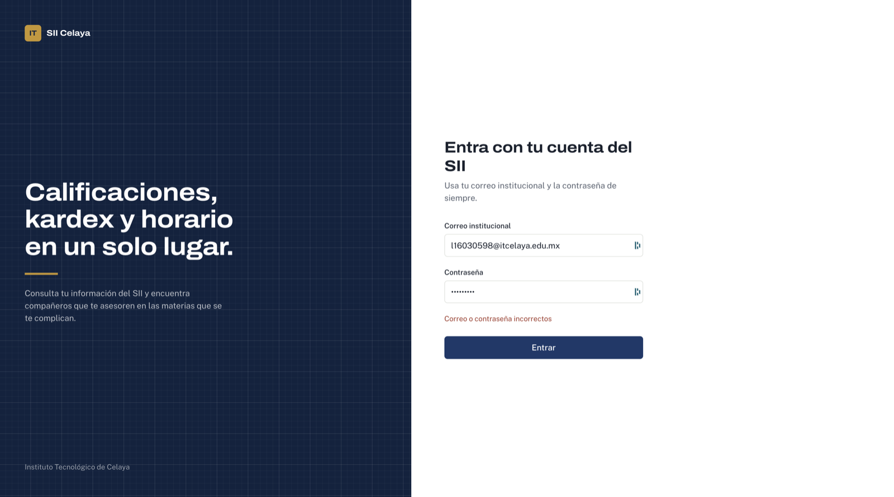
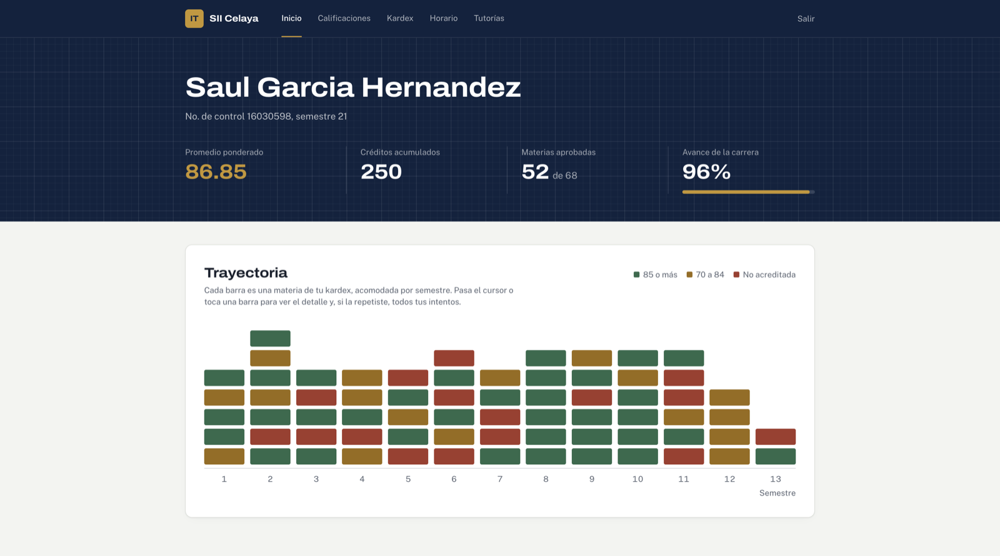
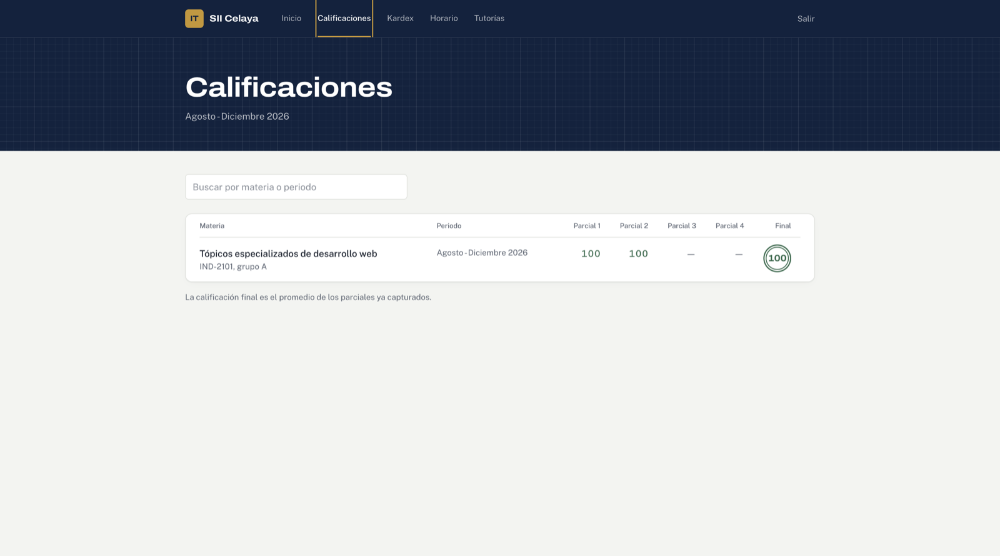
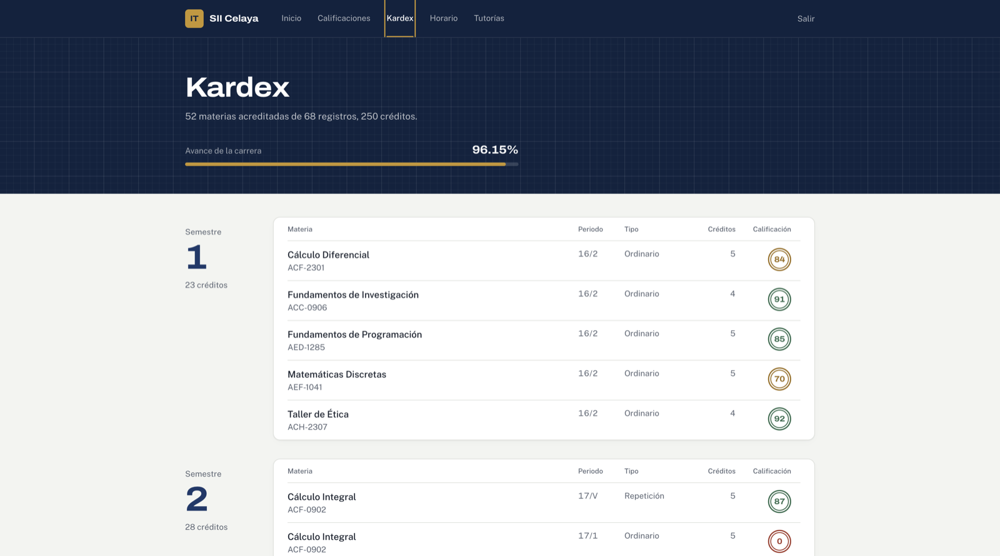
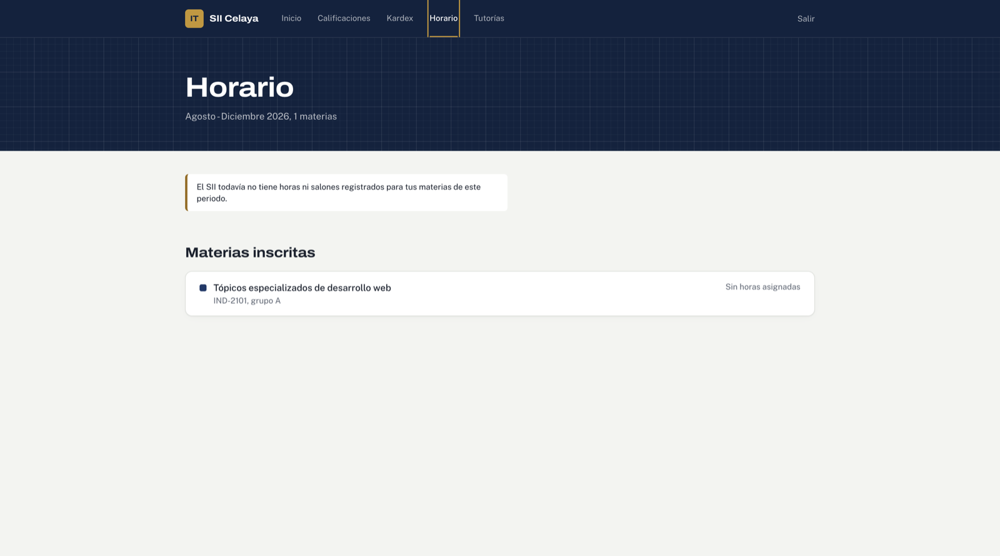
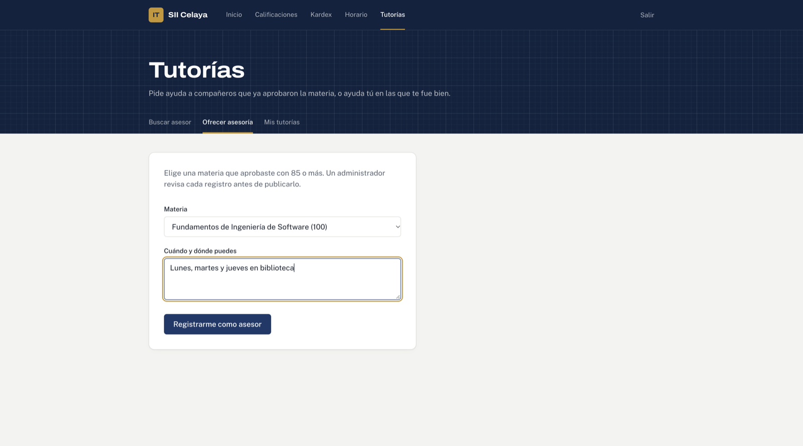
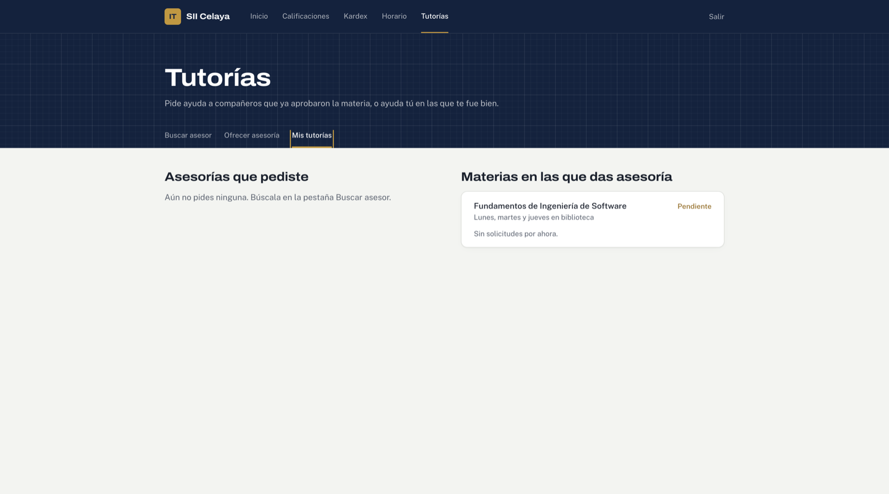
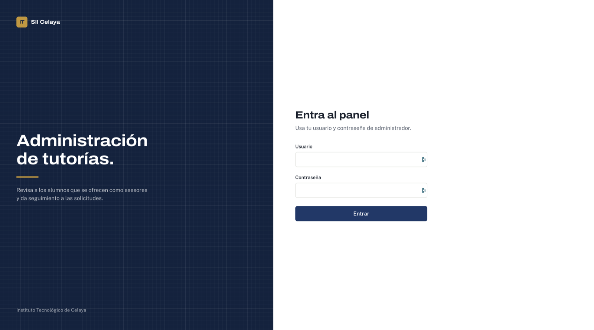
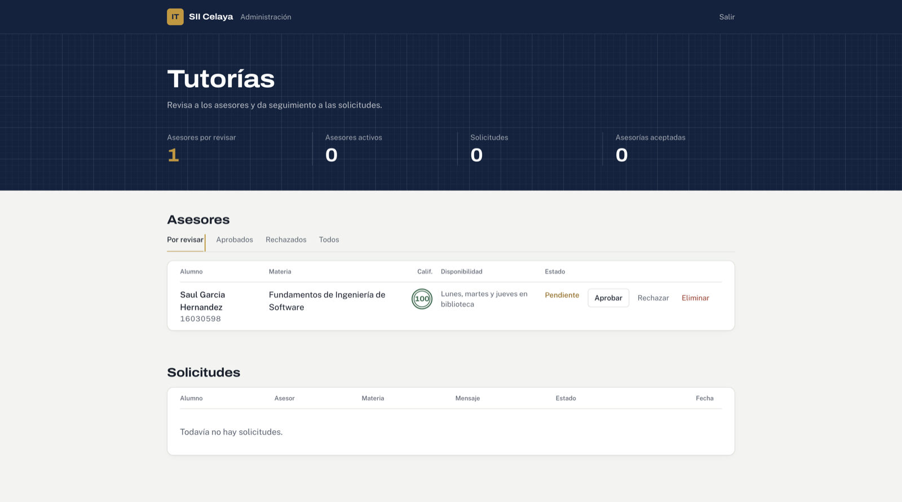

# SII ITC - Examen 3

Saúl García Hernández (16030598) · Tópicos de Desarrollo Web · Instituto Tecnológico de Celaya

Publicado en: https://examen3-sii.vercel.app (administración en https://examen3-sii.vercel.app/admin)

Aplicación web que consume la API del SII del Instituto Tecnológico de Celaya para que el alumno inicie sesión y consulte su perfil, calificaciones, kardex y horario.

## Tecnología

Usamos **Next.js** (App Router). Lo elegimos porque en un mismo proyecto tenemos el front en React y el backend con las API Routes, y se publica directo en Vercel.

El backend local hace de intermediario con el SII:

- `POST /api/auth/login` manda el correo y contraseña al SII y guarda el token en una cookie `httpOnly`, así el navegador no lo puede leer desde JavaScript.
- `POST /api/auth/logout` borra la cookie.
- `GET /api/sii/[seccion]` (`perfil`, `calificaciones`, `kardex`, `horarios`) llama al SII con el header `Authorization: Bearer <token>`.
- `proxy.js` protege las rutas de `/dashboard`: si no hay token o ya expiró, regresa al login. También protege `/admin` con la sesión del administrador.

## Funcionalidad adicional: tutorías entre alumnos

Los alumnos que aprobaron una materia con 85 o más pueden registrarse como asesores, y los demás les piden ayuda. La calificación se revisa contra el kardex real del SII, así que nadie puede ofrecerse en una materia que no domina. En "Buscar asesor" se sugieren las materias que el alumno reprobó alguna vez.

- Un administrador aprueba o rechaza a los asesores en `/admin`, con su propio usuario y contraseña.
- El asesor acepta o rechaza las solicitudes; al aceptar, los dos ven el correo del otro.
- Los datos se guardan en Supabase (Postgres). Solo el backend tiene la llave, el navegador nunca habla directo con la base.

La justificación de la propuesta está en [PROPUESTA.md](PROPUESTA.md).

## Instalación

Se necesita Node.js 20.9 o más reciente y una cuenta de Supabase.

```bash
git clone https://github.com/slashgarciaitc/examen3-sii.git
cd examen3-sii
npm install
cp .env.example .env.local
```

1. Crear un proyecto en Supabase y correr `supabase/tablas.sql` en el SQL Editor.
2. Llenar `.env.local` (`SII_URL` ya viene con la dirección del SII): `SUPABASE_URL` y `SUPABASE_SERVICE_ROLE_KEY` (Project Settings → API) y `ADMIN_SECRET` (cualquier texto largo, por ejemplo `openssl rand -hex 32`).
3. Crear el primer administrador:

```bash
node --env-file=.env.local scripts/crear-admin.mjs admin unaContraseña
```

4. Levantar el proyecto:

```bash
npm run dev
```

Abrir http://localhost:3000 (alumnos) y http://localhost:3000/admin (administración).

Para correr la versión de producción:

```bash
npm run build
npm start
```

En Vercel se importa el repositorio y se agregan las mismas cuatro variables de `.env.local` en Settings → Environment Variables.

## Capturas

Inicio de sesión con credenciales incorrectas:



Inicio con los datos del perfil y la trayectoria por semestre:



Calificaciones del semestre actual:



Kardex agrupado por semestre:



Horario (el SII todavía no tiene horas asignadas para este periodo):



Tutorías: registro como asesor y su estado en "Mis tutorías":





Panel de administración:




